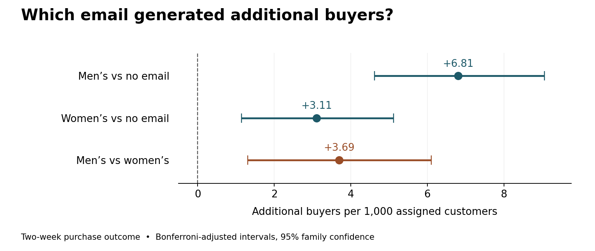

# Retail promotion measurement

**Which email should a retailer send to generate more buyers?** In Kevin Hillstrom’s randomized email experiment, the men’s-merchandise creative generated **6.81 additional buyers per 1,000 assigned customers** versus no email. It also beat the women’s-merchandise creative by **3.69 buyers per 1,000** in a direct comparison. I would choose the men’s creative for a comparable audience when the objective is two-week purchase conversion.



## Results

| Assignment | Assigned customers | Buyers | Two-week purchase rate |
|---|---:|---:|---:|
| No email | 21,306 | 122 | 0.573% |
| Men’s-merchandise email | 21,307 | 267 | 1.253% |
| Women’s-merchandise email | 21,387 | 189 | 0.884% |

| Comparison | Additional buyers per 1,000 | 95% simultaneous confidence interval |
|---|---:|---:|
| Men’s email vs no email | +6.81 | +4.62 to +9.06 |
| Women’s email vs no email | +3.11 | +1.14 to +5.12 |
| Men’s vs women’s email | +3.69 | +1.31 to +6.11 |

For example, `1,000 × (267 / 21,307 − 122 / 21,306) = 6.805`. The unit is extra **buyers** per 1,000 assignments. A buyer can make multiple orders, but the source conversion field records one binary outcome. The two merchandise labels describe the content of the emails.

## Reproduce

Use Python 3.10 or later. From the repository root, in a Python environment of your choice, run:

```sh
python -m pip install -r requirements.txt
python run_analysis.py
python -m unittest discover -s tests -v
```

The example was run with Python 3.12 and Matplotlib 3.10.8. SQLite is included in Python. The runner uses the complete local CSV when available. After a fresh Git clone it fetches the source automatically and verifies its SHA-256. The downloaded archive includes the raw CSV for offline analysis once Python and Matplotlib are installed. A successful run writes a queryable SQLite database and regenerates every file under `reports/`. Re-running replaces the previous analysis database.

The optional [walkthrough notebook](notebooks/promotion_measurement.ipynb) also contains executed results. To explore it interactively, install JupyterLab with `python -m pip install jupyterlab`, then run `python -m jupyter lab` from the repository root.

## Method

1. **Define the decision.** Use purchase within two weeks as the primary endpoint. The causal estimand is the absolute difference in purchase probability under assignment to each creative or holdout within the challenge population.
2. **Preserve random assignment.** Analyse all 64,000 rows using the original assignment. Filtering to visitors would condition on a post-treatment outcome and remove part of the email’s effect.
3. **Aggregate in SQL.** Check group sizes and input integrity. For each arm count assignments, visits and buyers, then compute purchase rate and gross spend per assignment. Include zero-spend customers. See the [SQL query](sql/arm_summary.sql).
4. **Estimate uncertainty in Python.** Use Newcombe’s independent-proportions score interval (method 10) with Wilson component limits, without continuity correction. The comparison family is fixed to the two campaigns against control and the creatives against each other. Bonferroni allocates 0.05/3 to each two-sided interval, giving approximately 95% simultaneous coverage across all three. This adjustment accommodates the shared holdout.
5. **Choose a creative.** Both emails outperform holdout. The direct men’s-minus-women’s interval lies entirely above zero, supporting the men’s creative for this purchasing objective.

Randomization supports an intention-to-treat interpretation if allocation was implemented as described, follow-up measurement was comparable across arms, and one customer’s assignment did not change another’s outcome. Every assigned customer counts regardless of delivery, opening, clicking or visiting. The spend figures describe gross revenue. Estimating profit would also require costs and margins. A contemporary audience and different creative warrant a new holdout.

## Repository guide

| Path | Purpose |
|---|---|
| [run_analysis.py](run_analysis.py) | End-to-end command and database creation |
| [promotion/data.py](promotion/data.py) | Source retrieval, checksum and input validation |
| [sql/arm_summary.sql](sql/arm_summary.sql) | Denominators, converters and revenue aggregates |
| [promotion/analysis.py](promotion/analysis.py) | Risk differences and adjusted confidence intervals |
| [promotion/report.py](promotion/report.py) | Chart, CSVs and decision memo |
| [notebooks/promotion_measurement.ipynb](notebooks/promotion_measurement.ipynb) | Guided, executable analysis |
| [reports/decision.md](reports/decision.md) | Decision brief with counts, lift and business limits |
| [reports/arm_summary.csv](reports/arm_summary.csv) · [reports/campaign_effects.csv](reports/campaign_effects.csv) | Unrounded machine-readable results |
| [tests/test_analysis.py](tests/test_analysis.py) | Boundary tests, denominator checks and regression tests |
| [data/README.md](data/README.md) | Attribution, field dictionary, checksum and sharing notes |

## Publish your copy on GitHub

Extract the ZIP and open a terminal in the directory containing this README. Create an empty GitHub repository, then use the commands below. Replace YOUR_USERNAME with your account name.

```sh
git init -b main
git add .
git status --short
git commit -m "Analyse the Hillstrom retail email experiment"
git remote add origin https://github.com/YOUR_USERNAME/retail-promotion-measurement.git
git push -u origin main
```

The raw CSV and generated database are excluded by `.gitignore`. A clone of the published repository can recover the verified data with `python run_analysis.py`. See the [data notes](data/README.md) for attribution and the sharing details.

## Sources

- [Kevin Hillstrom’s MineThatData E-Mail Analytics and Data Mining Challenge](https://blog.minethatdata.com/2008/03/minethatdata-e-mail-analytics-and-data.html)
- [Hillstrom dataset documentation](https://www.uplift-modeling.com/en/latest/api/datasets/fetch_hillstrom.html)
- [Newcombe (1998), Interval estimation for the difference between independent proportions](https://pubmed.ncbi.nlm.nih.gov/9595617/)
