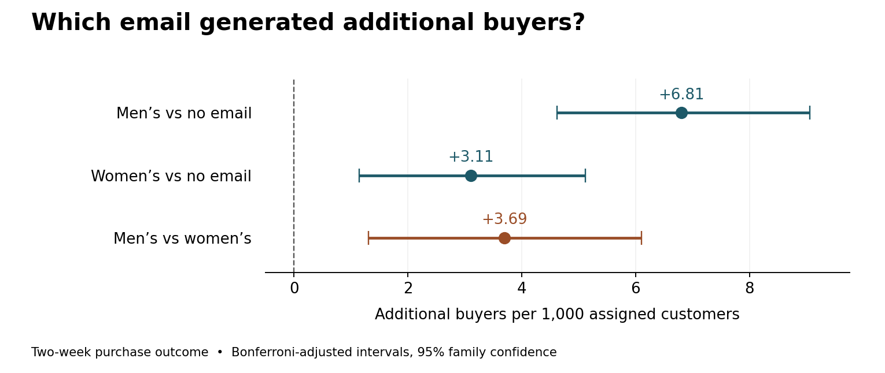

# Campaign decision

**Choose the men’s-merchandise email to maximize the number of buyers in a comparable audience.**

The outcome is a customer making at least one purchase within two weeks of assignment.

| Assignment | Customers | Buyers | Purchase rate | Gross spend per assigned customer |
|---|---:|---:|---:|---:|
| No email | 21,306 | 122 | 0.573% | $0.65 |
| Men’s merchandise | 21,307 | 267 | 1.253% | $1.42 |
| Women’s merchandise | 21,387 | 189 | 0.884% | $1.08 |

| Comparison | Additional buyers per 1,000 | 95% simultaneous confidence interval |
|---|---:|---:|
| Men’s merchandise vs no email | +6.81 | [+4.62, +9.06] |
| Women’s merchandise vs no email | +3.11 | [+1.14, +5.12] |
| Men’s merchandise vs women’s merchandise | +3.69 | [+1.31, +6.11] |

## Interpretation

The intervals use the Newcombe score method with a Bonferroni adjustment for approximately 95% simultaneous confidence across the three comparisons. The head-to-head row directly estimates the difference between the creatives. The labels identify the merchandise featured in each email. Customers were randomly allocated across all three groups.

The spend column includes zeros for non-buyers. It measures observed gross revenue per assignment. Choosing a campaign for profit would also require contribution margins, sending costs and the cost of any incentives.

These estimates describe the historical challenge population and its two-week follow-up. A current rollout should use a comparable audience and retain a randomized holdout to measure whether the effect carries over.
